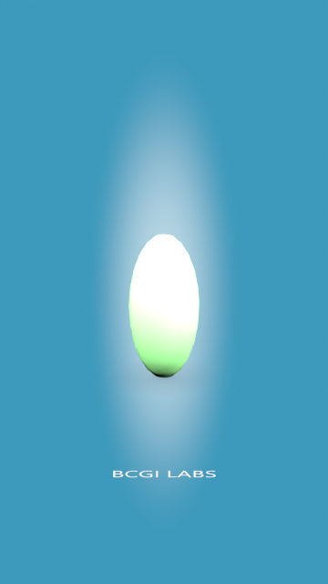
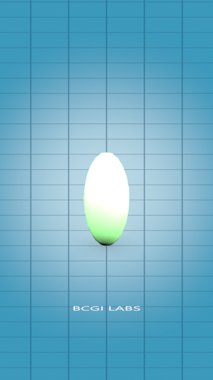
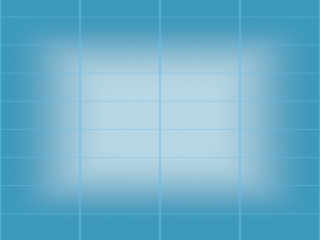
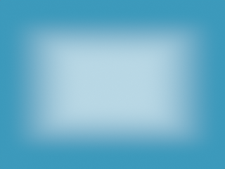
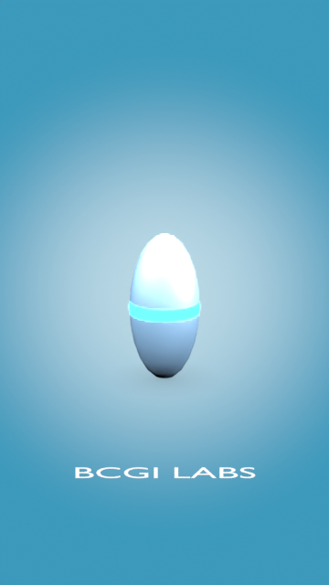
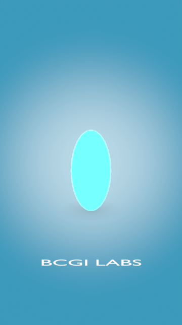
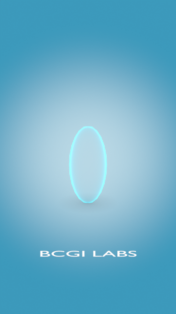

# BCGI LABS for Blender

**v0.4.1 · Build 20261014 · Tested in Blender 5.2.2 LTS on Windows**



## Install

Download [the add-on ZIP](dist/BCGI_LABS_v0.4.1_Build20261014.zip).
Open **Edit → Preferences → Add-ons → Install from Disk**, select the ZIP,
enable **BCGI LABS**, then open **3D View → N sidebar → BCGI LABS**.

## Infinity studio

**Add / Update Infinite Studio** creates a continuous disk floor, 360-degree
curved enclosure, matching sky, procedural gradient and linked background lights.
Reusing this button updates the current studio without duplicating it.

- **Infinity Studio** switches the studio on/off and restores the previous world
  when off. It does not delete the studio.
- **Follow Camera** follows the active scene camera's horizontal world movement
  and yaw, including through a parent rig. Ground height stays fixed. It rebinds
  automatically when the active camera changes.
- Color, glow position/spread, size, brightness and shadow controls update live.
  Floor, backdrop and sky use the same camera-space gradient. Their base color
  stays continuous regardless of surface orientation. Contact AO supplies local
  grounding shadows without diffuse lighting producing a visible floor/wall boundary.
  Background Light Power scales the shared gradient brightness.
- **Background Light Power** controls lights linked to studio geometry.
- Select the character mesh or armature, then **Add Lights for Selected Character**.
  **Character Light Power** controls that separate rig, linked to those meshes.

The world color is visible to camera rays without acting as ambient character
lighting. The camera-facing gradient is isolated from indirect emission. Use
Cycles for the verified light-linking result. Legacy Studio Lights adds general
unrestricted lights.

The enclosure is large finite geometry, not mathematically infinite. Normal
shots from inside it show no edges. Extreme positions, vertical travel or very
small studio sizes may require increasing Studio Size. The preview uses a
simple test object and Standard color management. Lighting and color management
affect the final appearance. Existing cameras and source rigs are preserved.

## Floor grid and branding



**Floor Grid:** color, spacing, line width and opacity. This is a renderable
material grid, separate from the global viewport grid. Distances use scene units.

**Floor Branding:**

- **Text:** installed Windows-font dropdown, Segoe UI default, custom TTF/OTF
  loading, text, color, size, position and rotation.
- **PNG Logo:** transparent PNG loading, tint, width, position and rotation.
  Image proportions are preserved.

Loaded images/fonts are packed into the local saved scene. Windows fonts and
user reference screenshots are not distributed here. Use material preview or
rendered shading; enable Scene World and Scene Lights in material preview to
evaluate the studio's actual sky and lighting. Solid shading hides materials.

## Grid, shape and scene controls in v0.4.1

- **Studio Floor** can be disabled independently. The procedural sky/cove stay
  active, while BCGI floor, grid and floor branding hide. Add your own road or
  mesh normally; its geometry/materials are not modified.
- **Glow Shape:** Circle, Oval, Square and Rounded Square. Spread controls the
  outer size; **Glow Feather** controls smooth blending. Aspect Ratio stretches
  the non-circular shapes; Corner Roundness adjusts Rounded Square. Floor,
  backdrop and sky use the same shape field. Circle accounts for render aspect.
- The floor grid uses **world X/Y coordinates**, anchored at world origin. It
  stays aligned with Blender's axes when the camera/studio moves or rotates.
  Grid Box Size, Line Width, Color, Opacity and Glow Strength are adjustable.
- **Hide Viewport Grid** temporarily hides Blender's floor/ortho grid and X/Y
  axes while the BCGI grid is active. Turning it off restores the previous
  viewport settings, including after save/reopen.
- Grid Glow adds emission and enables a Fog Glow compositor for final-render
  halos. High enough brightness is required to cross the glare threshold.
- **Center Whole Scene** recenters visible non-BCGI mesh bounds in X/Y and
  aligns their lowest point with Z=0. With no content mesh it centers the camera
  horizontally. Camera rigs, visible lights and content move together under a
  control Empty; existing child rig hierarchy stays intact. The active studio
  follows the move without double-translating. Undo restores the operation.




## Preset library

Seven Geometry Nodes modifier assets: **Wave, Scatter, Twist, Pulse, Scan, Glow,
X-ray**. Select a mesh and click **Apply Preset to Selected Mesh**. The modifier
is editable and preserves the underlying mesh.

Click **Install / Refresh Asset Library**. In an Asset Browser choose **BCGI LABS**,
then drag a preset onto the mesh in a 3D View. Native asset-based modifier import
was verified in live Blender. Assets are also supplied in `asset_library/`.

Adjust modifier inputs. Hover a value and press **I**, or click **Keyframe Latest
FX Controls**. Change the frame/value and insert another keyframe. Scan Position
runs from 0 to 1 along the object's generated height. Wave, Twist and Pulse also
expose Scene Time speed controls.





Glow applies an emissive material and adds a Fog Glow compositor node around
the existing image output in Blender 5.2. The halo appears in final composited
renders; material preview shows emission. X-ray is a transparent stylized edge
effect. Evaluated materials change through the modifier; source material slots
are retained. Remove the modifier to undo. Wave needs sufficient subdivisions.
Scatter adds instances inside the mesh bounds.

Legacy effect-copy buttons and gray/white/dark cycloramas remain available.
Motion retargeting, character creation and fire/smoke simulation are not included.

## Verification

Checks cover original tools, infinity toggling, parented-camera movement/yaw,
linked lighting, Windows fonts, PNG size/tint, keyframes, seven presets and asset
export. Actual Cycles renders were inspected for the studio, grid, Scan, Glow
and X-ray. Live installation and native asset import passed.

The native scanner needs UI events, so import is `NOT_RUN_BACKGROUND` in the
offline test and verified separately in live Blender. Literal mouse drag/drop,
another PC and other Blender releases have not been tested. A factory-startup
fresh file and its save/reopen in a separate Blender process were verified using
the installed v0.4.1 add-on, including camera follow, grid and packed font settings.
No restart was required in the verified session.

```text
blender --background --factory-startup --python test_bcgi.py
blender --background --factory-startup --python test_infinite_studio.py
blender --background --factory-startup --python test_gradient_seam.py
blender --background --factory-startup --python verify_fresh_file.py
blender --background --factory-startup --python verify_fresh_reopen.py
blender --background --factory-startup --python test_grid_shapes.py
blender --background --factory-startup --python test_scene_center.py
```

Tests create disposable scenes and render outputs. Source: `bcgi_labs/`.
Reports: `validation/`. BCGI logo supplied by BCGI LABS.
